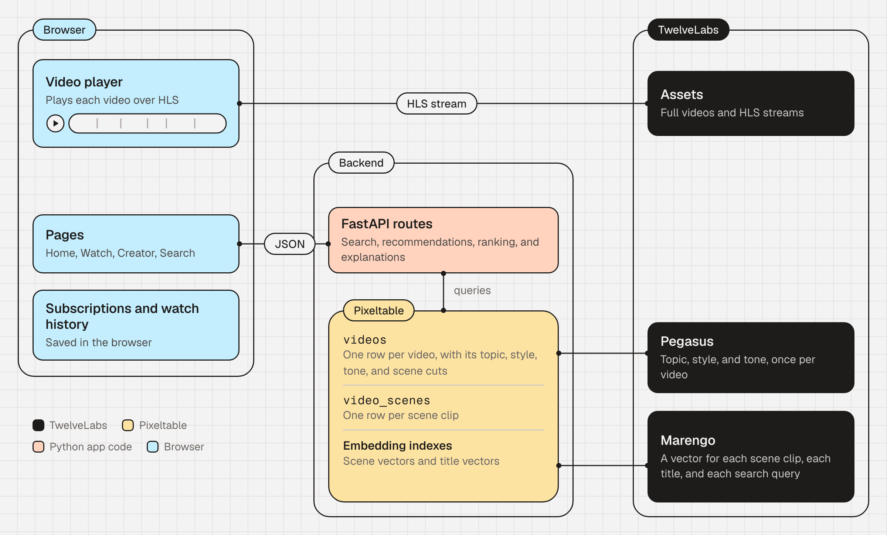
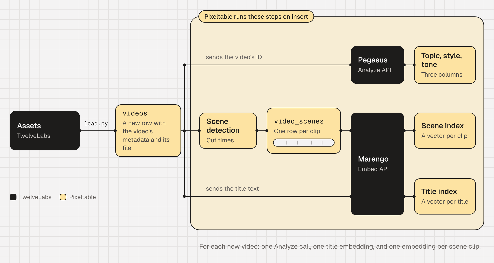
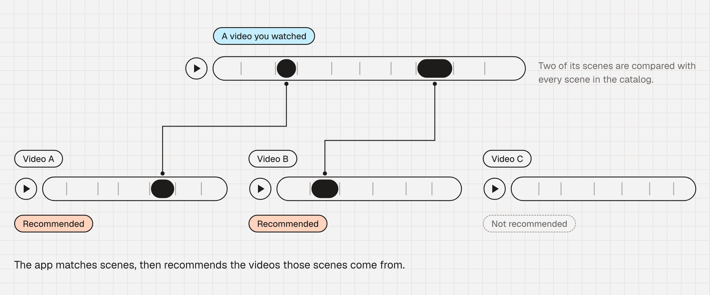
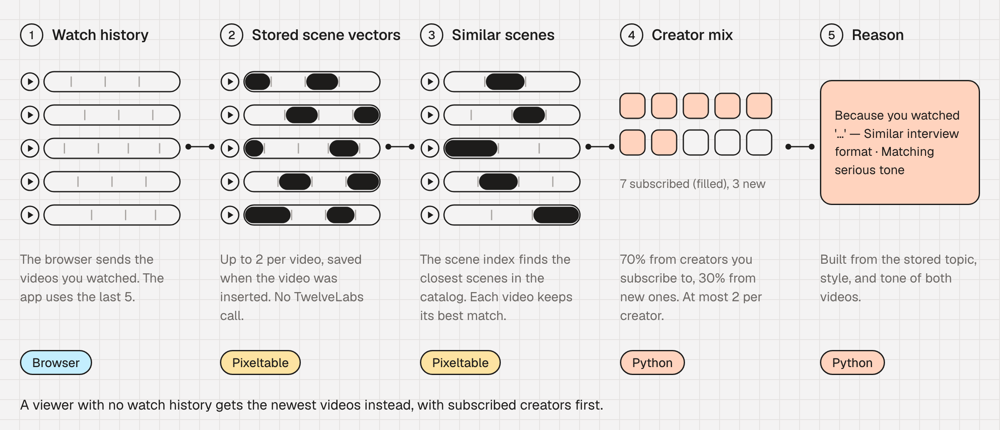

[Code on GitHub](https://github.com/mrnkim/substack-style-rec)

## Why Long-Form Video Discovery Breaks on Metadata

Creator platforms now host large catalogs of long-form video, from interviews and documentaries to video essays and lectures. Discovery on most of them still depends on view counts, metadata, and upload dates, so recent uploads take the top rows and strong older videos drop out of view.

Discovery across creators stays shallow too, because two videos about the same idea rarely share a title or a tag. Substack TV is a recent example: its app launched in beta in January 2026 with a "For You" row, and it lists [search and improved discovery](https://on.substack.com/p/introducing-the-substack-tv-app-now) as what's coming next.

Ranking on video content requires two capabilities.

The first is understanding what happens in every scene of every video, and this is where [TwelveLabs](https://www.twelvelabs.io/) comes in. [Marengo](https://www.twelvelabs.io/marengo) creates embeddings for video, audio, images, and text in one shared space, so a scene can be compared with a text query, an image, or another video. [Pegasus](https://www.twelvelabs.io/pegasus) generates structured attributes for each video through the [Analyze API](https://www.twelvelabs.io/product/analyze).

The second is keeping that understanding synced with the catalog for fast lookup, in a way that can be surfaced to users. Pixeltable, an open source multimodal backend, covers that half. In a production application, the model output has to be computed for every scene, kept current as videos and models change, and served on every page load without a new model call. With [Pixeltable](https://www.pixeltable.com/), you keep the TwelveLabs output synced with the catalog, compute it on insert, and serve it to users from one application.

Together, these two tools can power more effective long-form discovery through four features that rank videos by content instead of by title or tag:

- **"For You" Row Intelligence:** Recommendations built from the scenes a viewer has watched, mixing creators they follow with creators they haven't found yet.
- **Deep Catalog Surfacing:** A creator's back catalog ranked by relevance to each viewer, so strong older videos come back into view.
- **Cross-Creator Discovery:** Similar videos from other creators when the content matches, even if the titles and tags don't.
- **Explainable Recommendations:** A short reason with each recommendation that names what the two videos share, such as topic, style, or tone.

This post walks through CuratorAI, a working demo of all four features. By the end, you'll know how the application turns each new video into scene vectors and attributes on insert, and how it serves recommendations from them in about a second.

Try the [live demo](https://substack-style-rec.vercel.app): watch two or three videos, then go back to the home page to see the "For You" row update.

<!-- TODO: record the demo video and embed it here (required: 90% of TwelveLabs posts) -->

## Video Recommendation System Architecture



*Figure 1: TwelveLabs provides the video understanding and the playback, while Pixeltable stores that context with the catalog and serves it to the frontend.*

CuratorAI has three parts: a Next.js frontend, a backend built on Pixeltable, and TwelveLabs. From TwelveLabs, CuratorAI uses two models, Marengo 3.5 and Pegasus 1.5 at the time of writing, and the videos themselves:

- **Pegasus:** A video-to-text model that analyzes multiple modalities and can return structured JSON. It accepts videos up to two hours long, so one Analyze request covers a full episode.
- **[TwelveLabs assets](https://docs.twelvelabs.io/v1.3/api-reference/assets):** The full videos with their HLS streams, thumbnails, and custom metadata. CuratorAI streams playback from them and reads each video's creator, category, and upload date during loading. Search and recommendations don't query the assets: they run on Pixeltable's embedding indexes.

The application calls TwelveLabs when a video is inserted, not when a page loads. At insert, each video gets one Analyze call, one Marengo embedding for its title, and one for each scene. Each search embeds the query with Marengo, and a recommendation makes no TwelveLabs call at all.



*Figure 2: Pixeltable runs every step in the yellow area when a new video is inserted.*

## Why Scenes Are the Unit of Discovery

A long-form video usually covers many subjects, and a 40-minute interview can move from the guest's childhood to the business of streaming to a song they wrote last year.

CuratorAI gives each scene its own embedding, so a search or a recommendation can match one part of a video, such as the song in that interview, and still lead to the whole video.

The 25 demo videos hold about 11.6 hours of footage, split into 476 scenes.

The app matches scenes, but it recommends whole videos. In Figure 3, two scenes from a video you watched match scenes in Video A and Video B, so the app recommends those two videos.



*Figure 3: Scenes are what the app matches, and whole videos are what it recommends.*

Scene detection runs on each video when it's inserted, and a Pixeltable view splits the video at those cuts and indexes each clip:

```python
marengo = pxtf.twelvelabs.embed.using(model_name="marengo3.5")
marengo_async = pxtf.twelvelabs.async_embed_asset.using(model_name="marengo3.5")

class VideoScenes(
    TableModel,
    name="video_scenes",
    base=Videos,
    iterator=pxtf.video.video_splitter(
        video=Videos.video, segment_times=Videos.scenes[1:].start_time, mode="fast"
    ),
):
    __indexes__ = [
        pxt.EmbeddingIndex(
            video_segment,
            video_embed=marengo_async,
            audio_embed=marengo_async,
            string_embed=marengo,
            image_embed=marengo,
        )
    ]
```

The index embeds every clip with Marengo when the row is inserted. Most scene clips run longer than 30 seconds, the limit for a synchronous Marengo 3.5 call. So the index embeds each clip with `async_embed_asset`, which runs an embedding task in the TwelveLabs [Embed API](https://docs.twelvelabs.io/docs/guides/create-embeddings) and returns one vector for the clip's video and audio. Text and image queries use the synchronous `embed`, through `marengo`.

## Video Attributes with Pegasus

When a video is inserted, Pixeltable also calls the Analyze API once, through a short user-defined function, `analyze_video`, and stores Pegasus's topic, style, and tone as columns on the video's row. The function sends the video's TwelveLabs asset ID to Pegasus, so the video isn't uploaded a second time:

```python
@pxt.udf(is_deterministic=False)
async def analyze_video(video_id: str) -> VideoAttributes:
    ...
    payload = {
        "model_name": "pegasus1.5",
        "video": {"type": "asset_id", "asset_id": asset_id},
        "prompt": config.ANALYZE_PROMPT,
    }
```

The prompt asks Pegasus for a list of topics, one of eight styles, and one of six tones. Here is part of it, which limits each answer to a fixed set of options:

```plain text
style options (pick exactly one):
- "interview": one-on-one or panel conversation with a guest
- "documentary": narrative-driven visual storytelling, observational
- "explainer": educational breakdown of a concept using visuals or animation

tone options (pick exactly one):
- "serious": formal, weighty subject matter, measured delivery
- "contemplative": reflective, slow-paced, thought-provoking
```

Fixed options keep Pegasus's attributes consistent across the whole catalog, and the explanations below depend on that consistency.

## The Four Discovery Features

Each feature combines a semantic signal from TwelveLabs with a similarity query that runs inside Pixeltable.

### "For You" Row Intelligence

The home row starts from the five most recently watched videos. For each one, the application reads up to two of its stored scene vectors and queries the scene index with them:

```python
# simplified from backend/routers/recommendations.py
rows = (
    scenes_t.where(scenes_t.id == video_id)
    .select(vec=scenes_t.video_segment.embedding())
    .collect()
)
sim = scenes_t.video_segment.similarity(vector=rows[0]["vec"])
```

Marengo computed these vectors when each video was inserted, so the query makes no TwelveLabs call.

Plain Python then ranks the results. It fills 70% of the row from subscribed creators and 30% from new ones, and no creator gets more than two recommendations. The row changes as you watch, because each watched video becomes another source for the query.



*Figure 4: How the app builds a For You row.*

### Deep Catalog Surfacing

A creator page runs the same scene query, filtered by `creator_id`. Its "Recommended from this creator" row ranks the back catalog by how close each video is to what you watched, not by upload date.

### Cross-Creator Discovery

The Up Next list on the watch page searches with the current video's stored scene vectors across the whole catalog.

<!-- TODO: add one real Up Next result from the live demo, with scores, captured on the day of publication -->

### Explainable Recommendations

Each recommendation carries a short explanation built from the Pegasus attributes of both videos. A typical line reads: "Because you watched 'How to legislate AI' — Similar interview format · Matching serious tone." <!-- TODO(verify): capture the exact line from the live demo -->

A template builds the explanation, not a language model, so it adds no delay and says only what the stored attributes support.

## Search with Any Query Type

The search page accepts text, an image, a video clip, or an audio file as the query.

For example, a text search for "music culture" returns Vox Earworm videos about smooth jazz, Stravinsky, and song fade-outs, although none of their titles contains either word. <!-- TODO(verify) on the live demo on the day of publication; observed 2026-09-30 -->

## What This Approach Makes Possible

Content-based discovery no longer has to be a large investment made up front. A team can try all four features on its own catalog and see whether older videos and new creators start to surface.

Marengo finds the scenes that titles miss, Pegasus gives each video attributes that a recommendation can cite, and Pixeltable keeps both next to the catalog and serves them.

To try it yourself, watch a few videos in the [CuratorAI live demo](https://substack-style-rec.vercel.app) and see the For You row change. Then get an API key in the [TwelveLabs Playground](https://playground.twelvelabs.io/) and clone the [CuratorAI repo](https://github.com/mrnkim/substack-style-rec) to build the same discovery features on your own videos. <!-- TODO(blocker): load.py reads one specific TwelveLabs index (69c37b67...), and other accounts get 403. Open question to Kyle. -->

## Resources

- [CuratorAI source code](https://github.com/mrnkim/substack-style-rec): the complete application, including the backend schema, the loading script, and the frontend.
- [CuratorAI live demo](https://substack-style-rec.vercel.app): the four features on 25 long-form videos from 10 creators.
- [Marengo](https://docs.twelvelabs.io/docs/concepts/models/marengo): the TwelveLabs embedding model for video, text, image, and audio.
- [Pegasus](https://docs.twelvelabs.io/docs/concepts/models/pegasus): the TwelveLabs video language model behind the Analyze API.
- [Analyze videos](https://docs.twelvelabs.io/v1.3/docs/guides/analyze-videos): the guide to prompts and structured output.
- [Create embeddings](https://docs.twelvelabs.io/docs/guides/create-embeddings): the Embed API guide for video, image, audio, and text embeddings.
- [Working with TwelveLabs in Pixeltable](https://docs.pixeltable.com/howto/providers/working-with-twelvelabs): the built-in Marengo functions.
- [How Pixeltable works](https://docs.pixeltable.com/overview/how-it-works): the application file, schema commands, and service commands.
- [Serving tables over HTTP](https://docs.pixeltable.com/howto/deployment/serving): `FastAPIRouter`, query routes, and generated API documentation.
- [Building Cross-Modal Video Search with TwelveLabs and Pixeltable](https://www.twelvelabs.io/blog/twelve-labs-and-pixeltable): the earlier tutorial, in notebook form.

<!-- Images still to capture (required: 80% of posts; the median post has 11): home For You row, watch page Up Next with reasons, creator page, text search results, image search results. -->
