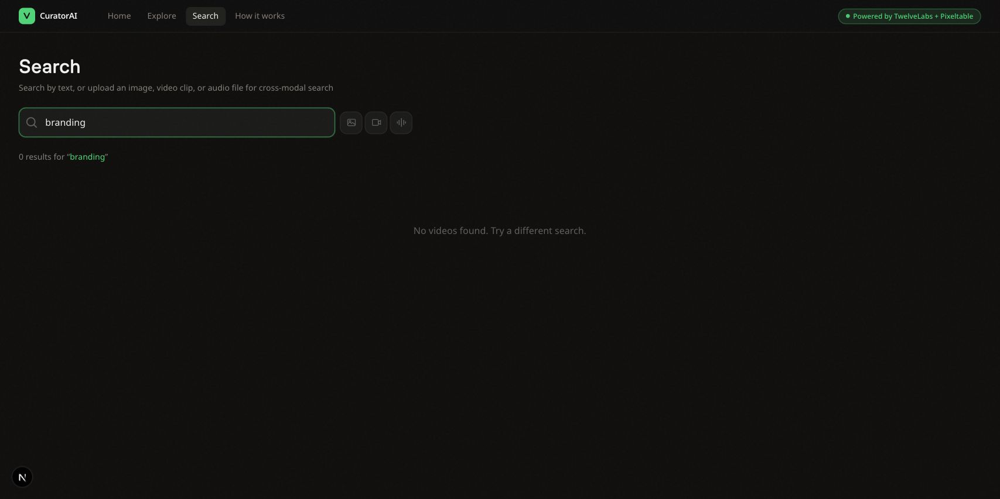

## Who, and the job

- **Person:** An unnamed viewer, inferred from CuratorAI’s Home screen; this was not a customer interview.
- **Situation:** Choosing something to watch in the rebuilt three-video demo.
- **Arrival kind:** Finish a job.
- **Job:** Find and start a video to watch.
- **Done:** The selected video plays and its playback time advances.
- **Leave:** Nothing suitable is identifiable, or playback fails without recovery.
- **Path:** Home → Watch Now → Home / Continue Watching → Explore → ColdFusion → Search → reopen Home.
- **Absent stages:** Account creation, checkout, publishing, and export.
- **Source:** Live local app, October 17, 2026; branch `codex/pr16-pixeltable-latest`, PR #16 head `6d4011f` plus the Pixeltable 0.7.18 dependency update. Shared card: [job.md](job.md).

## What I checked

- **“Continue Watching” does not resume playback.** Watched: a video reached `0:06 / 7:41`; reopening it through that row and pressing play started at zero. Read: [video-player.tsx](../src/components/video-player.tsx) restores no position; [user-state.tsx](../src/lib/user-state.tsx) stores video IDs, not playback times.
- **A service failure is presented as no matching videos.** Watched: temporarily stopping the local backend produced the empty-search message below. After restarting it and verifying its health, resubmitting stayed empty; a page reload recovered three results. Read: [api.ts](../src/lib/api.ts) converts failures to empty results, which the request cache retains for a minute on searches.
- Home, playback, return, Explore, creator follow/unfollow, search, and closing/reopening the tab were exercised live. I restored the backend and undid the test subscription. No app code changed.

## The session

### The viewer tries to find and start a video

1. **Arrival.** Home shows “CuratorAI,” the featured “Why more pop songs should end with a fade out,” “Watch Now,” and “More Info.” “For You” says “Based on your 3 subscriptions” before the viewer has chosen any. These are the demo’s preselected subscriptions, confirmed in source.

2. **First success.** “Watch Now” opens the watch page. The viewer presses the large play icon; the video displays `0:06 / 7:41`. The job is done once. “UP NEXT” offers two other videos with “Because you watched…” explanations. Playback works; a second choice is visible.

3. **Repeat and trouble: return.** Home now shows “Continue Watching” with the Vox video. Opening it returns to the poster and play button. Pressing play starts at zero, not the previous six-second position. The row remembers the title but does not continue the viewing session.

4. **Explore.** “Explore” says “Discover new creators and content beyond your subscriptions.” “Creators to Explore” offers The Futur and ColdFusion; the visible category rows are “Interview,” “Commentary,” and “Creative.” I looked for an empty category: absent categories are hidden, so there was no empty-category screen to exercise.

5. **Following and undo.** ColdFusion’s header offers “Subscribe,” while “Recommended from this creator” marks its card “FOLLOWING.” Both are visible together. Clicking “Subscribe” changes it to “Subscribed,” and that survives reloading. Clicking “Subscribed” undoes the test follow and returns the button to “Subscribe.” The contradictory card badge remains.

6. **Search.** The viewer follows “Search,” then the “music” button under “POPULAR TOPICS.” The screen returns `3 results for “music”`, including the Vox video. The input remains available for another query.

7. **Trouble: service unavailable.** With the local backend deliberately stopped, searching for “branding” shows `0 results for “branding”` and “No videos found. Try a different search.” There is no service-error explanation or retry button. After restoring the backend, pressing Enter still shows zero results. Reloading the page returns three results. The screen directs the viewer to change their query when the query was not the failure.

8. **Leaving and coming back.** I closed the tab and reopened Home. The Vox video was still under “Continue Watching,” and “For You” retained its “Because you watched…” explanations. History survives leaving this browser tab. The visited screens do not explain its browser-only storage. An overnight return was not tested.

## Problems first success creates

- **Resume later:** “Continue Watching” offers the right title, but the position is lost.
- **Choose another video:** “UP NEXT” and “Because you watched…” offer the next action; recommendation quality across a larger catalog remains untested.
- **Keep a creator:** “Subscribe” / “Subscribed” works and persists, but “FOLLOWING” can contradict it.
- **Keep history when leaving:** Reopening this browser works. Moving history to another browser or device remains open.

## Where the job broke

| # | Moment | What they needed | What the product did | Change | Size |
| --- | --- | --- | --- | --- | --- |
| 1 | 3 | Continue the video where they stopped | “Continue Watching” starts it at zero | Save playback position; show “Resume at 0:06” on its Home card, resume there, and offer “Start over” on the watch page. | Flow |
| 2 | 5 | Know whether they follow ColdFusion | Header says “Subscribe”; card says “FOLLOWING” | On creator recommendation cards, show “FOLLOWING” only for an actual subscription; otherwise use “DISCOVER.” | Small |
| 3 | 7 | Recover when search cannot reach its service | “No videos found. Try a different search.”; the failed result stays cached | On Search, show “Search is unavailable. Your query is saved.” with “Retry search.” Retry must fetch again; reserve the empty message for a successful search with no results. | Flow |

The conflicting creator labels are also saved in [this screenshot](creator-following.jpg). Upload errors and a genuine zero-match response were not exercised. The current three-video catalog limits conclusions about discovery quality.

## Follow-up scope

The user deferred the three UX changes above. Acceptance is now the current technical implementation, recommendation business rules, and accurate attribution to Pixeltable and TwelveLabs. The subsequent changes fix full-catalog pagination, leave failed Analyze tags unknown, and qualify provider-call and 70/30 claims in the app and README. The recorded walkthrough above describes the version before those changes.
